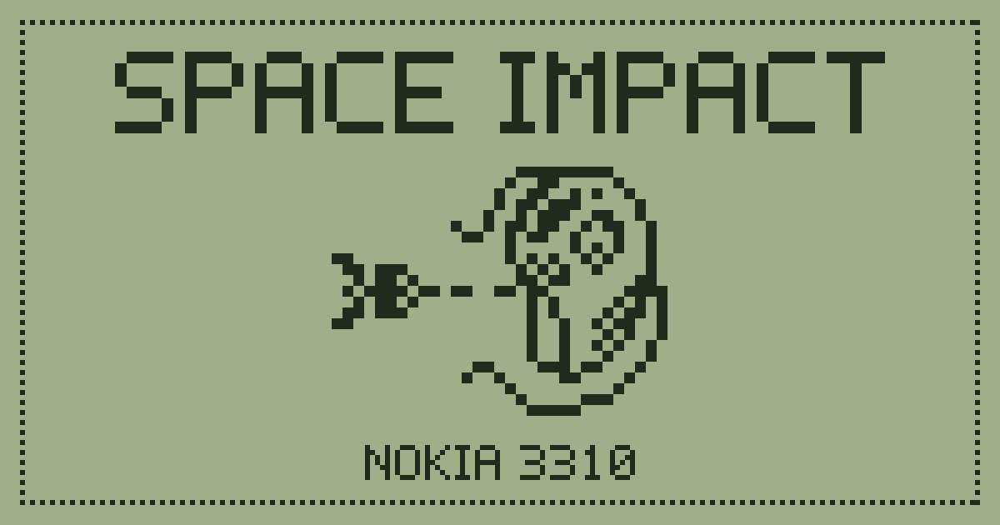
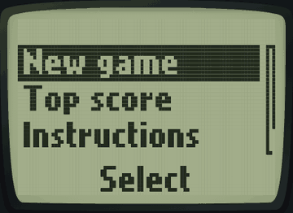
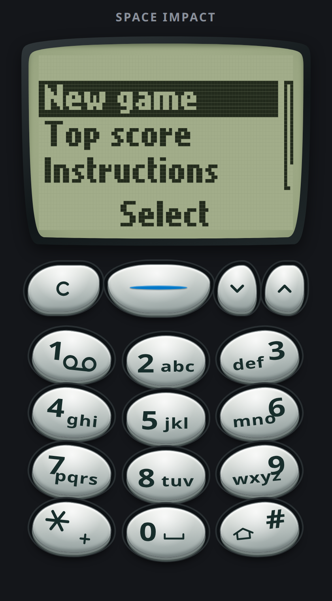

# Space Impact

The shooter of the Nokia 3310, rebuilt in a browser from data read out of the phone's own firmware, and checked against that firmware tick by tick.

[▶ Play it now](https://gamekiller168.github.io/Space_Impact/) · [How to play](#play) · [What is verified](#what-is-verified) · [How it was made](#how-it-was-made) · [Fidelity ledger](web/FIDELITY.md) · [Changelog](CHANGELOG.md)

 

The page is a phone: display, function keys and keypad. The recording was played by a script.

Space Impact is the side-scrolling shooter that came with the Nokia 3310. This repository is a fan-made recreation that runs in any modern browser, on a phone or on a desktop. It is built from the phone's own program: the pictures, levels, waves, enemy behaviour, bosses, texts and sounds are read from the firmware (v6.39, PPM B), and the game logic is compared with the original running in an ARM emulator.

> **Beta (v0.2).** The ordinary enemies, their shots, how your shots hit and score, the waves, the ship (lives, shield, terrain contact), pickups, the bonus weapon, the terrain and the texts follow the firmware and are checked against it by tests. The bosses of levels 1 to 7 and the level ends follow it too. The final boss of level 8 and the ending are still estimates. It is **not** a verified copy and not v1.0; [web/FIDELITY.md](web/FIDELITY.md) is the honest list.

## Play

**[▶ Play in your browser](https://gamekiller168.github.io/Space_Impact/)** (GitHub Pages, deployed from `web/` on every push to `main`).

It works on touch screens (several fingers at once, sliding between keys), with the keyboard, and offline once loaded; on a phone you can add it to the home screen and it runs as an app. The game, the settings and the top score are saved in the browser. The initial language follows the browser setting.

### Keys

| | Phone key | Keyboard |
| --- | --- | --- |
| Up / down | `8` / `0` | arrow keys or W / S |
| Back / forward | `*` / `#` | arrow keys or A / D |
| Main weapon (hold it to keep firing) | `1` or `3` | Space |
| Bonus weapon | `4` or `6` | Shift |
| Pause, back | `C` | Backspace, Escape or C |
| Scroll, select | scroll keys, middle key | up / down, Enter |

Options controls game sound, key tone, vibration and language. Key tone plays a short click when a key goes down and a lighter one when it comes back up (the click is modelled on a recording of a real keypad; its level and shape are estimates, not firmware data). Supported mobile browsers vibrate for the same events as the firmware.

### Run it locally

No build step, no dependencies, no server code: plain HTML, CSS and JavaScript.

- `cd web && python3 -m http.server 8080` and go to <http://localhost:8080> (`npm run serve` does the same), or
- copy the `web/` folder to any static web host (`tests/` and `package.json` are not needed there).

## The game

Eight levels, each a run of waves of enemies over a scrolling landscape, ending in a boss. You have three lives and a short shield at the start of each. Shots, hits and kills score points; defeated enemies sometimes leave pickups, among them ammunition for the bonus weapon on keys `4` and `6`. Touching an enemy, an enemy bullet or the terrain costs a life.

## What is verified

Verified means: the original handler was run in an emulator, the result was stored as a fixture, and a test makes the browser engine reproduce it exactly. Each row of the ledger names its fixture.

| Part of the game | Status |
| --- | --- |
| Pictures: all 84 image descriptors, the terrain of the eight levels | read from the firmware; terrain compared with the firmware's compositor at every scroll position |
| Level descriptors and wave schedule: 8 levels, 179 wave records | read from the firmware |
| Ordinary enemies: spawn, every movement mode, shooting, hit points | exact, tick by tick, including every random draw (159 wave records isolated; 139 match tick by tick in the shooting test) |
| Your ship: movement, shots, contact, explosion, respawn, shield, lives | exact against recorded firmware runs |
| Hits and scoring, pickups, the bonus weapon | exact against recorded firmware runs |
| Bosses of levels 1 to 7, and the flight at the end of a level | exact against the firmware |
| Menus, texts, Options | the labels of five PPM B languages and the instruction text of ten come from the firmware text tables |
| Sounds | the four ship and pickup tone scripts are decoded from the firmware; key clicks are an estimate |
| Final boss (level 8), boss death explosions, the ending | **approximated** |
| Compared with a real phone | **not yet** |

`cd web && npm test` runs the whole suite (Node 22).

## How it was made

1. **Find the game.** The app dispatcher of the firmware routes app ID 1 to the Space Impact wrapper. An earlier attempt had picked the wrong game (Pairs II); the ledger records that correction.
2. **Read the data.** Pictures, level and wave tables, terrain maps, texts and tone scripts are extracted with the scripts in [`tools/`](tools). The firmware image itself is **not** in this repository.
3. **Run the original.** `tools/` includes an ARM7 emulator that runs the game's own message handler with simulated phone services, and records what the real code does: positions, hit flags, random draws.
4. **Re-implement and compare.** The JavaScript engine is written module by module, and each one has a test that replays the recorded firmware trace.
5. **Say what is not known.** Anything that no recording could settle stays on the "estimated" list in the ledger.

The look of the page is shared with the sister project [Snake II](https://github.com/GameKiller168/Snake_II), a Nokia 3310 Snake II recreation with the same approach.

## What is in the repository

- [`web/`](web) is the page: HTML, CSS and plain JavaScript modules, a service worker for offline use, and the tests.
- [`tools/`](tools) are the Python and Node tools that extract data from a firmware image and record the fixtures. They need a Nokia 3310 v6.39 PPM B flash image, which you must supply; see [tools/README.md](tools/README.md).
- [`web/FIDELITY.md`](web/FIDELITY.md) says, for every part of the game, whether it was read from the firmware (and how it is tested) or estimated.
- [`CHANGELOG.md`](CHANGELOG.md) lists the releases.

## Releases

| Tag | What |
| --- | --- |
| `v0.2.0-beta.7` | Key tone on by default again, softer clicks |
| `v0.2.0-beta.6` | Key clicks modelled on a real keypad recording |
| `v0.2.0-beta.4` | Link preview card, click-style key sounds |
| `v0.2.0-beta.3` | Pictures drawn the right way round, bosses of levels 1 to 7 exact, new app icon |
| `v0.2.0-beta.2` | Hits and scoring, terrain contact, pickups, bonus weapon, lives |
| `v0.2.0-beta.1` | First playable engine |

## Credits and legal

Space Impact and the Nokia 3310 belong to Nokia. This is an unofficial fan project without any connection to Nokia or HMD Global, and it contains no firmware. The code is released under the [MIT License](LICENSE).
